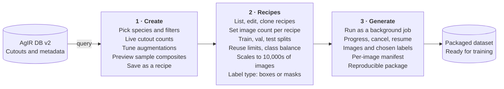

# SemiF-SyntheticPipeline GUI Design

Nov 17, 2026

A Streamlit app where users design recipes for synthetic images from AgIR DB cutouts, then generate datasets of tens of thousands of images from those recipes.

## Requirements

1. **Query the AgIR DB for cutouts.** Filter by species and any available metadata (area, growth stage, validated, primary, edge placement, blur).
2. **Scale to tens of thousands of images.** Users define recipes for the kinds of images they want, not individual images.
3. **Three tabs: Create, Recipes, Generate** (see [Workflow](#workflow)).
4. **Built in Streamlit.**
5. **Headless core.** The GUI calls the same pipeline code as the CLI, so large jobs can also run from a script.
6. **User-selected label type.** In the Recipes tab, the user chooses one or more label types for the dataset: detection boxes, semantic segmentation masks, instance segmentation masks. Generate writes only what was chosen.

## Data quality

- **Leakage-safe splits (Recipes tab).** Assign train, validation and test at the source level (plant, source image, batch or site), so no source appears in more than one split.
- **Cutout reuse limits.** Show how often each cutout and species is reused, and cap it per recipe.
- **Cutout augmentation.** A configurable Albumentations pipeline per recipe (color, brightness, blur, rotation, flips, scale jitter), applied to each placement so reused cutouts look different. Tunable and previewable in the Create tab.
- **Scale consistency.** Cutouts are placed at real-world size: cutout cm² per pixel matches the background's.
- **Backgrounds in the recipe.** Filter backgrounds by metadata or select individually. Anuraag has a version of this.
- **Labels from visible pixels.** Masks and boxes are computed after occlusion; instances below a minimum visible area are dropped.
- **Reproducible datasets.** Each dataset records the DB version, code version, seed and resolved cutout IDs, and can be regenerated identically.
- **Per-image manifest.** Every image records its recipe ID, cutout IDs, applied augmentations and seed.

## Workflow

A recipe describes one kind of image: species mix, cutout filters, cutouts per image and backgrounds. Scale comes from the Recipes tab, where each recipe gets an image count.

## Architecture

- **Streamlit app** with one page per tab, running on the server next to the data.
- **Pipeline core** as a plain Python package: AgIR DB query, recipe model, compositing. Build on Anuraag's `agir_db` source in `ajajoo3/update-pipeline`.
- **Recipes saved as files** (YAML or JSON), so they can be versioned, shared and run from the CLI.
- **Generation runs as a background job** outside the Streamlit session. It needs multiprocessing, progress reporting and resume after failure. Streamlit reruns its script on every interaction, so it cannot run long jobs itself.
- **Streamlit performance.** Streamlit reruns the whole script on every interaction. Use `st.cache_data` for DB queries, `st.fragment` for live counts and previews, and `st.form` to batch inputs. Keep pipeline logic out of the Streamlit files, so the core can move to another front end later.

## Open questions

- [ ] What has Anuraag built so far, and how much carries over?
- [ ] Where do packaged datasets go?
